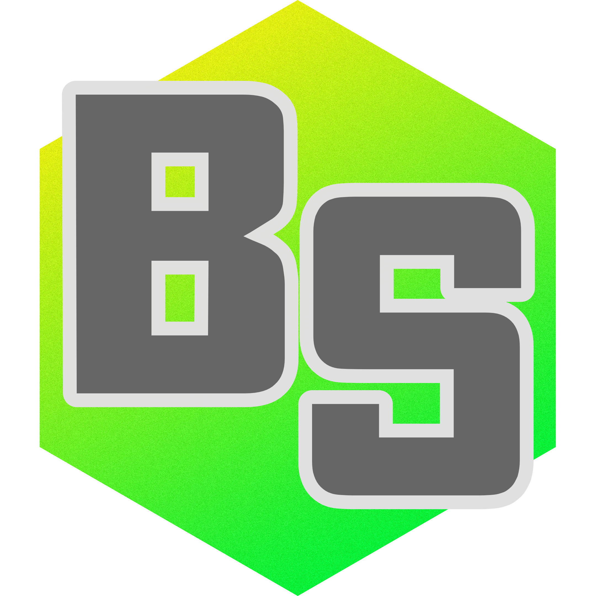

  

<h1 align="center">Border Studio</h1>

  
  

  A Windows app for streamers who want their webcam to sit in a shape they chose,
  with a border that matches the rest of the stream. You draw the hole, pick how
  the edge looks, and OBS shows your camera through that hole with the border on top.

  <a href="https://github.com/iamtew/borderstudio/releases/latest"><strong>Download</strong></a>
  &nbsp;·&nbsp;
  <a href="https://iamtew.github.io/borderstudio/"><strong>Documentation</strong></a>

MIT — Mikael 'tew'. See <a href="LICENSE">LICENSE</a>.

