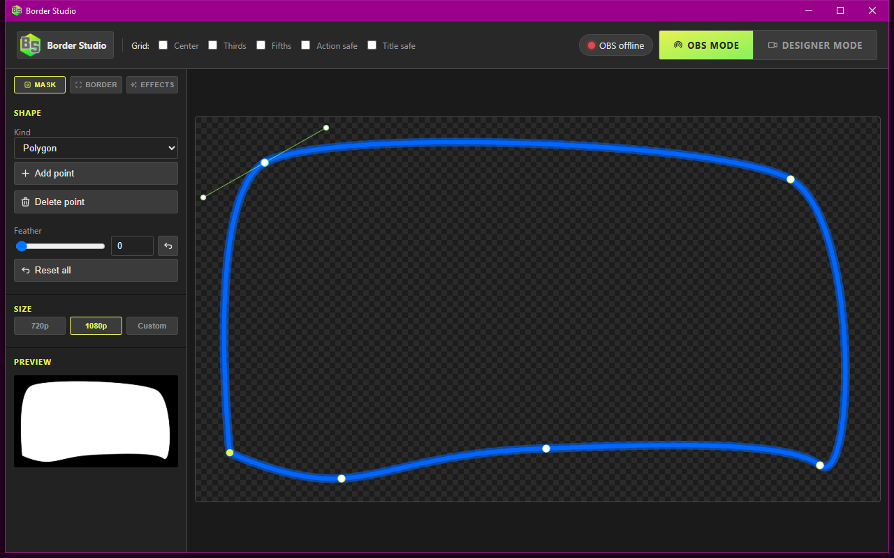
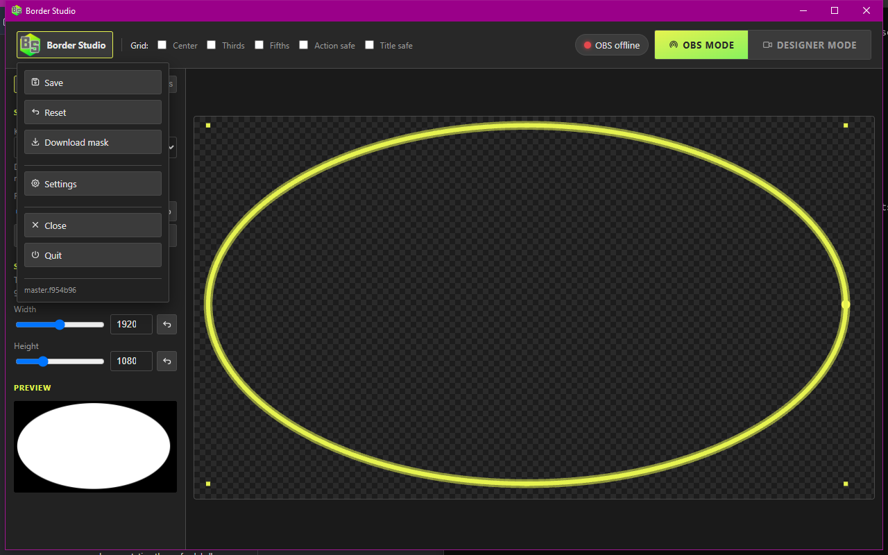
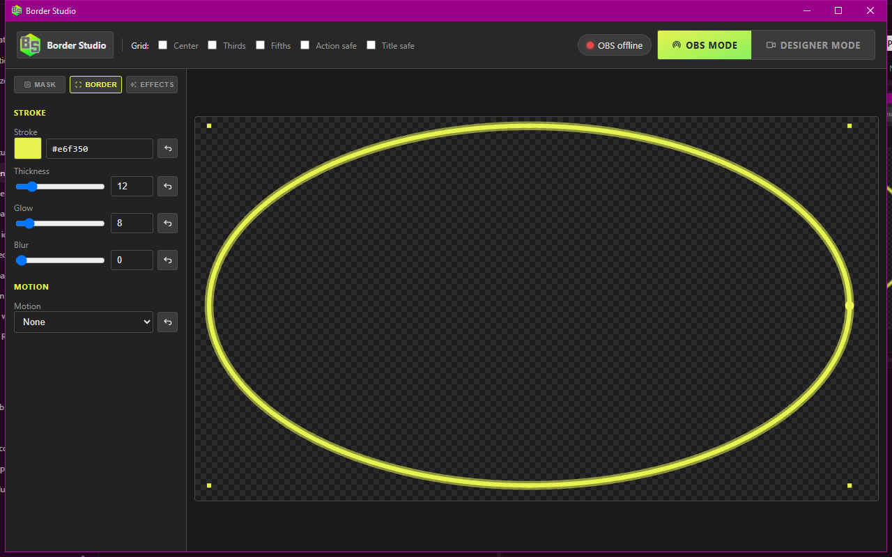
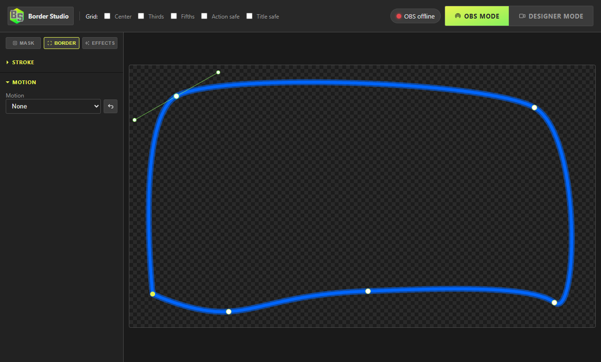
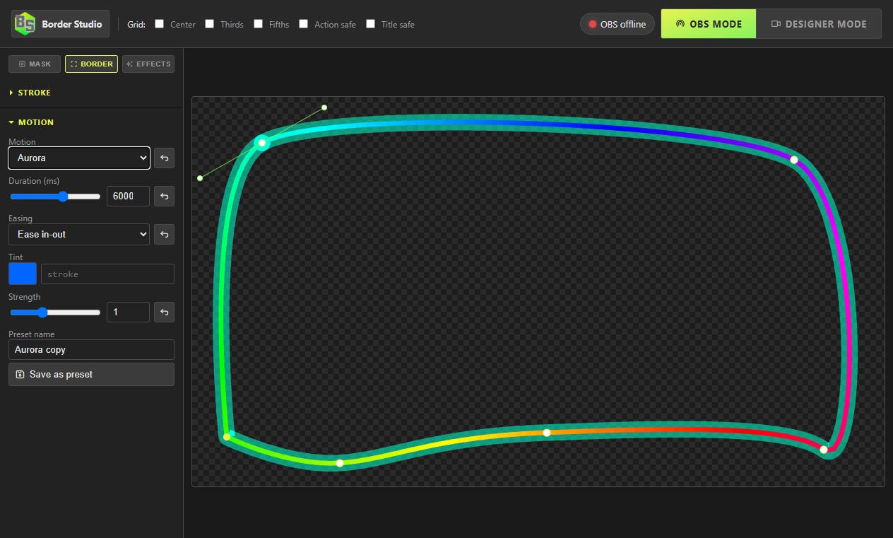

# Designer

The Designer is the app. One window: logo + **Border Studio** file menu on the left, grids and OBS controls on the right, a three-tab sidebar (**Mask**, **Border**, **Effects**), and the stage.

Ctrl+Z / Ctrl+Y (or Shift+Z) undo and redo. History caps at 80 steps. Numeric fields use a slider, a typed number, and a reset to that field’s default.

Edits auto-save about a quarter-second after you stop moving. **File → Save** stores a named copy of the hole and the border. It does not store the effect buttons.

## Chrome

Click the hex mark and **Border Studio** for:

- **Name** and the list above it — saved designs. Click a name to load that hole and border. Effect buttons stay.
- **Save** — store the current hole and border under **Name**. The same name overwrites. An empty name does nothing.
- **Delete** — remove the selected design.
- **Export** — download `borderstudio-designs.json` (every saved design, effect buttons left out).
- **Import** — merge that file by name. A file that is not this export, or a shape the app rejects, is ignored and the list stays as it was.
- **Reset** — default hole and default stroke, glow, and motion. Effect buttons stay. The selected design name clears.
- **Download mask** — PNG `border-mask.png` (white = visible camera, black = cut). Used if you ever fall back to Image Mask/Blend.
- **Settings** — OBS, Mode, Color palettes.
- **Help** — opens the docs Home (`docs.html`) in your browser.
- **Close** — hide the window; a toast says it is still in the tray.
- **Quit** — exit the process.

Version sits at the bottom of that menu.

Right-click on the stage (not in a text field) opens **Undo**, **Redo**, **Save**, **Settings**, plus **Delete point** / **Add point here** on a polygon, or **Delete effect** on an effect row. That **Save** writes the live design now. The named copy is **File → Save**.

**Grid** checkboxes draw framing lines. They are session-only — not saved with the design.

| Checkbox | Lines |
| --- | --- |
| Center | 50% |
| Thirds | 1/3, 2/3 |
| Fifths | 1/5 … 4/5 |
| Action safe | 5% / 95% |
| Title safe | 10% / 90% |

Vertices, bezier handles, and moved shapes snap to the canvas edges always, and to enabled grid lines, within 10 screen pixels.

The header pill shows **OBS connected** or **OBS offline** (click it for OBS settings). Next to it: **OBS mode** (camera stays with OBS) and **Designer mode** (webcam in the hole so you can see the cut). Stream in OBS mode. Details: [OBS](obs.md).

## Sidebar tabs

**Mask** is the camera hole.

**Kind:** polygon, rounded rect, circle, or oval.

- **Polygon:** click empty stage to add a vertex. Click a corner vertex *without dragging* to smooth it into a bezier; drag the handles to tune it. Clicking an already-smooth vertex does not unsmooth it. Right-click a vertex for **Delete point** (minimum three points). Delete / Backspace also deletes the selected vertex. Buttons: **Add point**, **Delete point**.
- **Rounded rect:** **Corner radius** 0–512, plus an on-stage radius handle.
- **Circle / oval:** drag the hole; eight box handles resize it.

**Shapes**, at the top of this tab, stores holes. Click a name to use that hole and canvas size. The border and the effect buttons stay. **Save** stores the current hole under **Name** (same name overwrites). **Delete** removes the selected hole.

**Feather** (0–64) blurs the hole edge (soft mask). **Size** is the hole: 720p (1280×720), 1080p (1920×1080), or Custom (width/height, min 16). Stroke and glow can extend outside the hole; the OBS overlay pads for that. **Preview** shows the black/white mask PNG. **Reset all** puts back the default chamfer and 1920×1080. Stroke, motion, and effect buttons stay.

**Border** is the overlay decoration: stroke, thickness, glow (halo), blur (softens the stroke), and motion.

**Stroke** fold (open by default): color via iro.js (box + hue + alpha) and a hex field. Thickness 1–80 (default 12), glow 0–80 (default 8), blur 0–64 (default 0). Stroke reset is `#e6f350`. Palette chips sit under the picker.

**Effects** is the one-shot board. See [Effects](effects.md).

The stage is a dark checkerboard (transparent). Glow and blur read against it. Designer mode still shows the webcam in the hole, using the same feathered mask as OBS.

If the local server dies, a banner says `Error: Border Studio application not running!`

## Motion

**Border → Motion** is the idle loop on the border. Fold **Stroke** to get the panel out of the way. **None** is a solid stroke. Pick a loop, then **Duration (ms)** (100–10000), **Easing**, **Tint** (empty = use the stroke color), and **Strength** (0–3). **Save as preset** stores that setup under **Mine**. Motion reset returns to None.

Aurora (Color group) walks a hue along the stroke:

Easing applies per keyframe segment, so **Steps** holds each key and dash loops wrap seamlessly. Labels: Ease, Ease in, Ease out, Ease in-out, Linear, Steps, Steps 2.

| Group | Loops |
| --- | --- |
| Dash | Dash, Dash reverse, Dash fast, Dots, Long dash, Flow |
| Travel | Scan, Comet, Orbit |
| Glow | Breathe, Glow pulse, Heartbeat, Shimmer, Neon |
| Color | Hue, Rainbow, Aurora, Neon swap, Fire, Chroma |

Chroma (idle or burst) hides the solid stroke and draws soft cyan and magenta copies of it. The copies thicken as they split, and the offset scales with the shape so the editor and the overlay match. Glitch keeps the stroke and tears it into chunks along the path, with a few bands flashing cyan or magenta. Fire puts tongues along the stroke instead of pulsing the whole border. Designer tint does not recolor the cyan and magenta copies.

Heartbeat exists twice: idle **Glow → Heartbeat** here, and a one-shot **Pulse → Heartbeat** on Effects. Same name, different job (`loop` vs fire-once).

## Settings

**File → Settings** has **OBS**, **Mode**, and **Color palettes**. Esc, the X, or click outside closes the dialog (OBS fields save on close).

**Color palettes:** built-ins cannot be edited (**Basic**, **Credits**, **Pastel**, **Neon**, **Sesh Sofa**, **Studio**, **Night**, **Warm**, **Ice**, **Hazard**, **VHS**). **New palette** takes a name and hex colors (one per line, or spaces/commas). Duplicate names merge into the existing custom palette. Stroke color uses the selected palette’s chips.

OBS connect and Mode auto-switch are on [OBS](obs.md).
