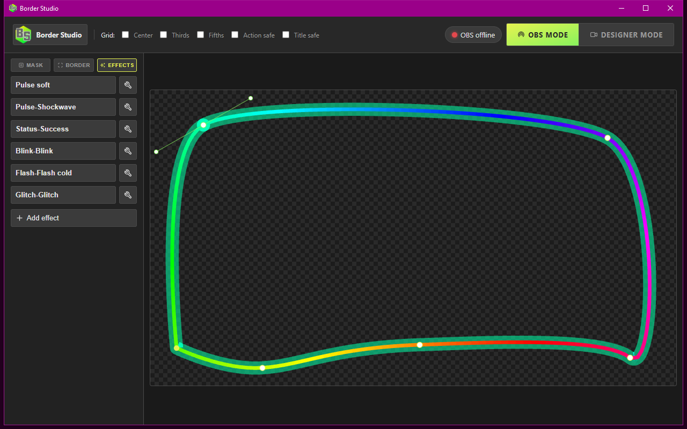

# Effects

Idle motion lives on **Border → Motion** and loops forever. **Effects** are one-shots: click a button, the overlay plays it once, and the Designer stage previews the same burst.

The **Effects** tab lists those buttons beside the stage. The wrench (`Edit effect`) opens that effect’s panel. **Add effect** is at the bottom of the list.

A new install already has buttons: Pulse, Double pulse, Heartbeat, Flash, Rainbow, Boom, Success, Warn, Alert, Strobe, Shake, Wipe, Spark, Chroma burst, Glitch. **Add effect** names the new button `Group-Label` (for example `Pulse-Pulse`) until you rename it.

The tray **Effects** item opens a second Designer window already on this tab. Same app, same design, same overlay. File **Close** on that window only closes the extra window.

## Edit panel

The wrench opens:

- **Back** — return to the button list.
- **Play** — audition on overlay and stage (same as clicking the button).
- **Name** — label on the button.
- **Animation** — which recipe to play (table below).
- **Duration**, **Easing**, **Tint**, **Strength** — same controls as idle motion; sliders have a reset.
- **Preset name** / **Save as preset** / **Delete preset** — custom recipes only; built-in ids cannot be stolen. Motion presets and effect presets share one store, split by whether they loop.
- **Delete effect** — remove this button.

Right-click an effect row for **Delete effect** as well.

## Animations

| Group | One-shots |
| --- | --- |
| Pulse | Pulse soft, Pulse, Pulse hard, Pulse double, Heartbeat, Swell, Snap, Shockwave |
| Flash | Flash, Flash white, Flash hot, Flash cold, Rainbow burst, Whiteout, Boom, Lightning |
| Status | Success, Warn, Alert |
| Blink | Blink, Flicker, Strobe |
| Move | Jolt, Shake |
| Sweep | Wipe, Reverse wipe, Spark |
| Glitch | Chroma burst, Glitch |

Chroma burst hides the solid stroke and splits it into red, green, and blue fringes. Glitch keeps the stroke, adds that split, and tears the ribbon into bands. See [Designer](designer.md) for idle Chroma / Glitch notes.

Fire a button while OBS is on the `Border Studio` scene (or any scene that nests it) to see it on stream. The overlay URL must stay alive: leave **Shutdown source when not visible** off on the browser source.
