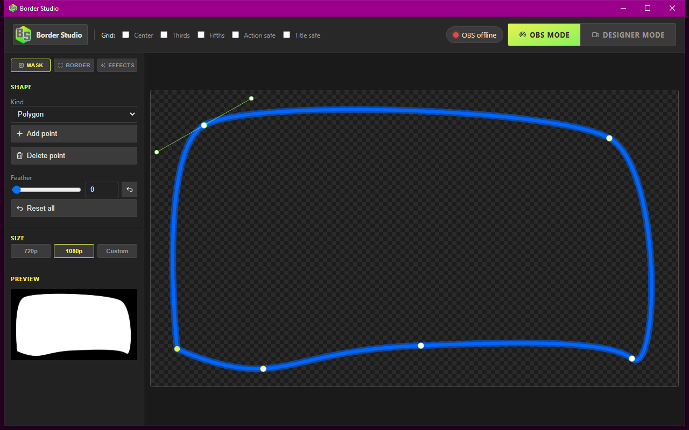

# Home

Border Studio is a Windows app for streamers. You draw a **hole** for the webcam, paint a **border** around it, and OBS shows the camera through that hole with the border on top.

The window that opens is the **Designer** — that is the whole app. Closing it leaves a tray icon; the overlay and mask keep serving until you **Quit**.

<strong>Required:</strong> <a href="https://obsproject.com/">OBS</a> and the <a href="https://github.com/FiniteSingularity/obs-advanced-masks">Advanced Masks</a> plugin. Border Studio will not build its scene without both. Advanced Masks is a hard dependency, same class as OBS itself — not optional, not “if you want fancy masks.” Install it before you connect.

## How to use the app

A normal session looks like this:

1. Install OBS, then [Advanced Masks](https://github.com/FiniteSingularity/obs-advanced-masks), then Border Studio (the MSI on [Releases](https://github.com/iamtew/borderstudio/releases/latest)).
2. In OBS: **Tools → WebSocket Server Settings**. Turn the server on. Note the port (default 4455) and password.
3. Launch **Border Studio** from Start. A tray icon means it is running. The Designer opens on its own.
4. **Border Studio → Settings → OBS**. Host `127.0.0.1`, your port and password. **Connect**, pick the camera, then **Create / Repair scene**. Without Advanced Masks this step fails and the owned scene does not work.
5. Switch the header to **Designer mode** while you shape the hole so the webcam shows in the cut. Switch to **OBS mode** before you go live so OBS keeps the camera.
6. **Mask** tab: draw the hole (polygon, rounded rect, circle, or oval). **Border** tab: color, thickness, glow, idle motion. **Effects** tab: one-shot buttons you fire on the overlay.
7. In OBS, nest the `Border Studio` scene into the scene you actually stream. Do not rename `Border Studio`, `BS Camera`, `BS Mask`, or `BS Overlay`.
8. Close the Designer when you are done editing. The tray keeps the local server up. **Quit** from the file menu or the tray is how the app actually exits.

Edits auto-save. **File → Reset** restores the default hole and border and leaves the effect buttons. **Mask → Reset all** restores only the hole.

The tray also has **Effects** (the button pad), **Copy effects URL** (same pad, for an OBS dock), **Clear browser data**, **About**, and **Quit**. The pad is `http://127.0.0.1:8505/effects`.

## Next

- [Quick Start](quick-start.md) — MSI, first connect, first hole.
- [Designer](designer.md) — chrome, mask, border, motion, palettes.
- [Effects](effects.md) — one-shots vs idle motion.
- [OBS](obs.md) — WebSocket, owned scene, modes.

Building from a clone is [For Developers](install.md).
