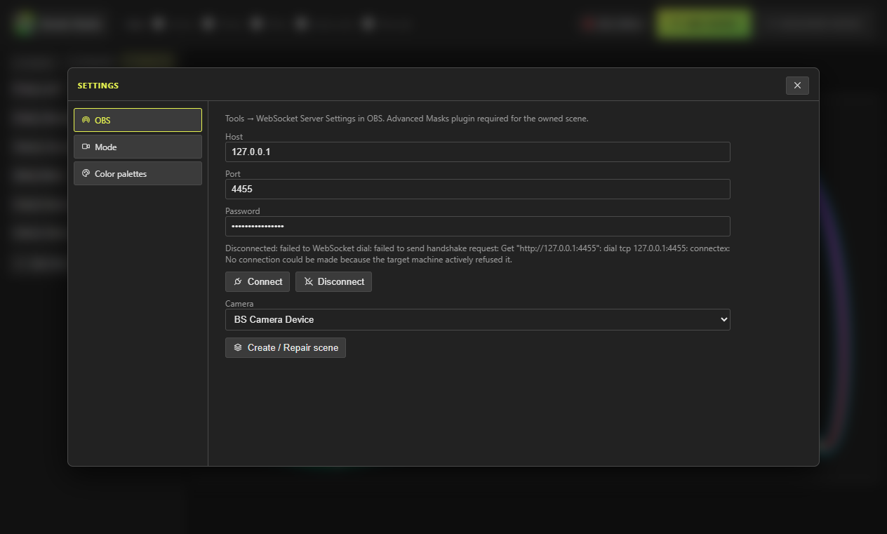

# OBS

<strong>Required:</strong> <a href="https://obsproject.com/">OBS</a> plus the <a href="https://github.com/FiniteSingularity/obs-advanced-masks">Advanced Masks</a> plugin. Create / Repair attaches an <strong>Advanced Mask</strong> filter to the camera wrap. Without that plugin, Border Studio cannot own the scene. This is a hard dependency, not an optional extra.

## Required plugins

1. OBS itself (Windows), with WebSocket available (**Tools → WebSocket Server Settings**). Turn the server **on**. Default port **4455**. A password is stored in Border Studio; if one is saved, the app auto-connects on launch. After **Connect**, a dropped socket retries every 5 seconds until you **Disconnect**.
2. [Advanced Masks](https://github.com/FiniteSingularity/obs-advanced-masks). Install it in OBS *before* you click **Create / Repair scene**. The app probes filter kind `advanced_masks_filter`. Miss it, and you get an alert pointing at that GitHub repo.

The Designer hint under Settings → OBS says the same thing: WebSocket in OBS, Advanced Masks required for the owned scene.

## Owned scene (WebSocket)

In the Designer: **Border Studio → Settings → OBS** (or click the header pill **OBS connected** / **OBS offline**). **Host**, **Port**, **Password**, **Connect**, **Disconnect**, **Camera**, then **Create / Repair scene**. Camera list is DirectShow video inputs only. If there is no existing camera (or the dedicated **BS Camera Device** is selected), a **Webcam** row appears to pick the device id.

**Create / Repair** will Connect first if needed. Success copy: the `Border Studio` scene is ready — nest it in your other scenes. Overlay size follows OBS’s base canvas (default 1920×1080). Layout resyncs shortly after you edit the design while connected.

Do not rename these sources:

| Name | Role |
| --- | --- |
| `Border Studio` | Scene you nest into the stream |
| `BS Camera` | Nested wrap around your existing camera so the mask filter can sit on it |
| `BS Mask` | Browser source `http://127.0.0.1:8505/mask` (parked off-canvas; the live hole) |
| `BS Overlay` | Browser source `http://127.0.0.1:8505/overlay` (border ink, restacked on top) |

`BS Mask` is not meant to be visible in the scene; it exists so Advanced Masks can use it as the mask source. Overlay and mask browsers stay up (`shutdown` off) so live updates keep flowing.

## Modes

The header pill shows whether OBS is connected (click it for OBS settings). The switch next to it is **OBS mode** (left) and **Designer mode** (right):

- **Designer mode** deactivates the Border Studio camera in OBS and shows that webcam inside the hole on the Designer stage, masked exactly like OBS will. The mask, overlay, and OBS scene still update live. If the browser cannot open the camera, you get an alert and it falls back to OBS mode.
- **OBS mode** releases the webcam back to OBS. **Stream in OBS mode.** Closing the last Designer window hands the camera back to OBS automatically, even if the header still said Designer mode.

**Border Studio → Settings → Mode** sets the default when a window opens, whether to switch when OBS goes offline (Designer) or comes online (OBS mode), and a **Grace (seconds)** so a brief blip does not flip the camera. Auto-switch only follows OBS going online or offline; it does not override a manual click while OBS stays in the same state. New installs default to OBS mode, both auto-switches on, grace 0.

## Last-ditch fallback

The product path is Create / Repair + Advanced Masks. If you cannot install plugins and only need a static cut, you can still:

1. Add your camera source.
2. Filter → **Image Mask/Blend**. Use the PNG from **Border Studio → Download mask** (white = visible camera, black = cut). That PNG does not update live the way `BS Mask` does.
3. Add a Browser Source on top: `http://127.0.0.1:8505/overlay` (same size as the mask, default 1920×1080). **Shutdown source when not visible** stays off so SSE stays up. The live mask page is `http://127.0.0.1:8505/mask`. Overlay ink is PixiJS (WebGL inside OBS). If the border is blank, turn on OBS hardware acceleration (**Settings → Advanced**).

This fallback does not replace Advanced Masks for the owned scene. Install the plugin.
