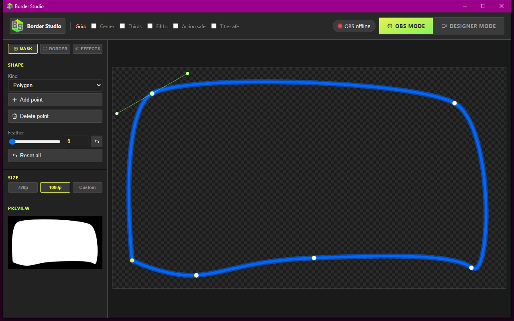

# Quick Start

## Install

1. Open the [latest release](https://github.com/iamtew/borderstudio/releases/latest). Download the Windows installer: `borderstudio-*-win-x64.msi` (not the `.zip`).
2. Run the MSI. It is per-user, no admin. Default folder is `%LOCALAPPDATA%\Programs\Border Studio`. Next through; Start Menu shortcut is on, desktop is off unless you tick it.
3. Launch **Border Studio** from Start. A tray icon means it is running. The window that opens is the **Designer** — that is the whole app.

Portable: unzip `borderstudio-*-win-x64.zip` and run `borderstudio.exe`.

## First run

1. In OBS: **Tools → WebSocket Server Settings**. Turn the server on. Install [Advanced Masks](https://github.com/FiniteSingularity/obs-advanced-masks) if you do not have it.
2. In Border Studio: click the logo name **Border Studio → Settings → OBS**. Connect, pick your camera, then **Create / Repair scene**.
3. On the **Mask** tab, draw the hole (polygon, rounded rect, circle, or oval).
4. On the **Border** tab, pick color, thickness, glow, and any idle motion.
5. In OBS, nest the `Border Studio` scene into the scene you actually stream.
6. Switch the header to **OBS mode** before you go live so OBS keeps the camera.

Effects, grids, palettes, and the fallback mask PNG live on the other pages.

See [Designer](designer.md), [Effects](effects.md), and [OBS](obs.md). Building from a git clone is on [Install from source](install.md).
